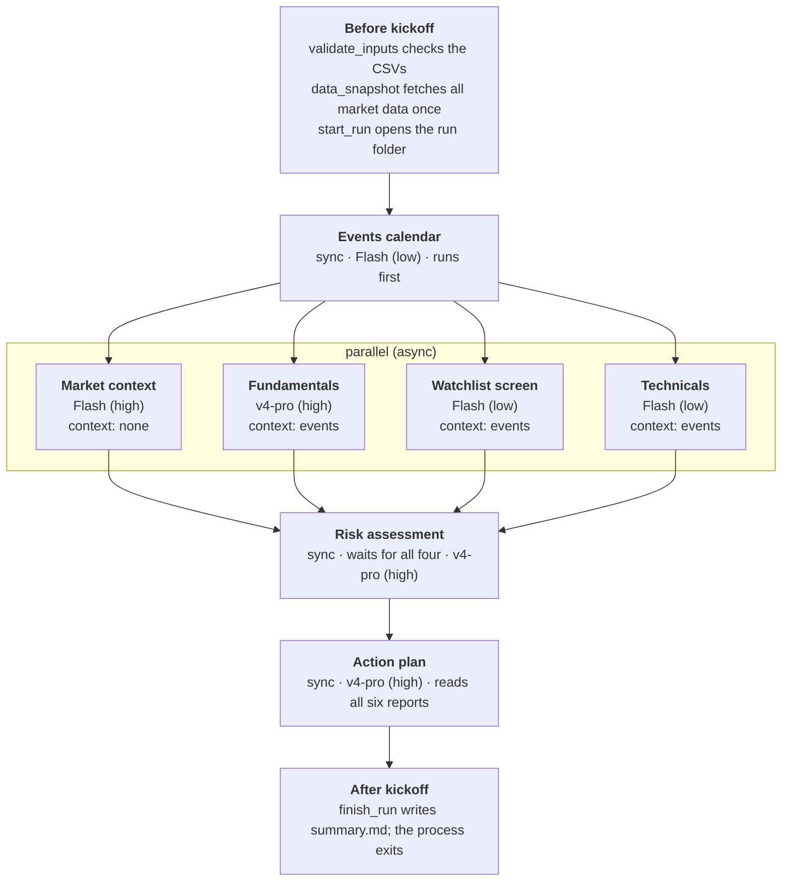
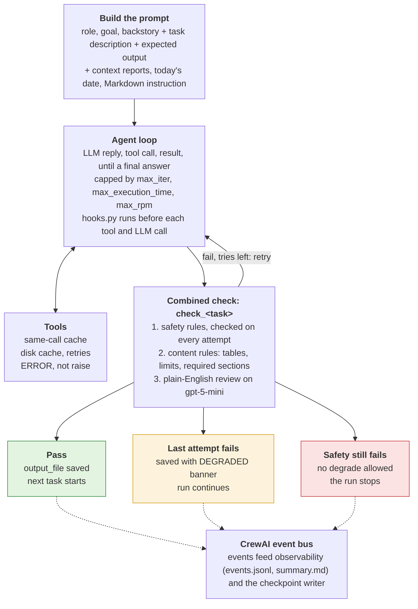

# How the Portfolio Advisor crew works in CrewAI

How CrewAI loads and runs the eight agents, how data flows between tasks, and why each setting has the value it has. Written for CrewAI 1.15.

## What `crewai run` does

`crewai run` turns two kinds of JSONC files into Python objects, then starts one kickoff. Nothing runs until every agent, tool and task has loaded, so a broken reference fails in seconds, not mid-run.

1. **Load the crew.** `crewai.project.crew_loader.load_crew` reads `crew.jsonc` (crew settings, inputs, risk profile, tasks) and each `agents/<name>.jsonc` (role, goal, backstory, model, tools, limits).
2. **Build the agents.** Each agent's `"llm"` is a Python reference, `{"python": "models.<agent>"}`. CrewAI reads that attribute from `models.py`, which looks up the agent's tier and the chosen provider in `models.jsonc` and returns an `LLM` object. A `deepseek/...` model goes through CrewAI's OpenAI-compatible client to api.deepseek.com; Anthropic and Gemini use CrewAI's native clients. Because the model is picked at load time, `MODEL_PROVIDER=openai crewai run` switches every agent without editing a file.
3. **Load the tools.** Each `custom:<name>` entry imports `tools/<name>.py` and takes the first `BaseTool` subclass in it. Built-in tools (web search, website reader) load by name.
4. **Resolve Python references.** Every `{"python": "module.attr"}` (guardrails, before/after kickoff callbacks) is imported from the project root, so `guardrails.py`, `observability.py` and `hooks.py` sit beside `crew.jsonc`.
5. **Kick off and exit.** With `CREWAI_DMN=1` in `.env`, CrewAI skips its full-screen display and input prompts, prints plain output, and the process ends when the action plan is saved.

## Kickoff and the run timeline

The run fetches all market data once, before any agent starts, then each task gets only its slice.

- **Before-kickoff callbacks** run in order: `guardrails.validate_inputs` checks the CSVs, sets `file_date`, and calls `data_snapshot.build`, which fills the `{data_*}` inputs and saves `output/YYYYMMDD_00_data_snapshot.md`; then `observability.start_run` opens the run folder.
- **Interpolation.** CrewAI replaces every `{placeholder}` in agent goals and backstories, task descriptions and `output_file` paths with the inputs, so `{file_date}` names each report and `{data_events}` pastes the events data into the events prompt. Each agent's goal and backstory, and each task's description and expected output, are themselves placeholders (`{goal_risk_manager}`, `{description_risk_assessment_task}`), filled by `validate_inputs` from `agent_profiles.yaml` and `task_profiles.yaml`. CrewAI does not look inside the text it inserts, so `validate_inputs` fills the placeholders in that text (`{portfolio}`, `{data_events}`) itself, after the data snapshot.
- **Why fetch once.** If each agent called Yahoo on its own, the run would be slow, rate-limited and inconsistent between reports. Now every report reads the same numbers and agents call tools only for a gap or an `ERROR`.
- **After-kickoff callback** `observability.finish_run` writes the run report; with `CREWAI_DMN=1` the process then exits.

## Sequential process with parallel async tasks

The crew uses `Process.sequential`, with four tasks marked `async_execution: true` so they run at the same time. There is no manager agent: the order in `crew.jsonc` is the plan.

How CrewAI treats async tasks in a sequential crew:

- Consecutive async tasks start together, each in its own thread.
- The next sync task waits for all of them, then receives their outputs.
- An async task cannot list another async task in its `context` unless a sync task sits between them.
- A crew may end with at most one async task, so risk and plan stay sync.

Design decisions:

- **Events first, alone.** Holdings, watchlist and technicals read the events calendar (earnings dates change how a stock is judged), so events runs sync before them.
- **Four in parallel.** Market context, holdings fundamentals, watchlist screen and technicals do not read each other, so they share one wait instead of four.
- **A separate watchlist agent.** Screening the watchlist is a different job from reviewing holdings; splitting it keeps each prompt short and lets both run in parallel.
- **Technicals covers every symbol.** It reads holdings and watchlist together so the risk and plan steps have one table of levels to work from.
- **Risk, then plan.** Both need everything before them, so they run sync at the end on the stronger model.
- **No delegation.** `allow_delegation: false` on every agent: each agent does its own task, so cost and run time stay predictable.

## Context: how reports flow between tasks

A task reads earlier reports only through its `context` list; CrewAI pastes those reports' raw text into the prompt. Every token pasted is paid for again by the reading agent, so context is kept to what each task needs.

| Task | Reads (context) | Also gets from the data snapshot |
| --- | --- | --- |
| Events calendar | nothing (`[]`) | `{data_events}` |
| Market context | nothing (`[]`) | `{data_market}` (benchmarks + market internals: breadth, credit spreads, relative leadership) |
| Holdings fundamentals | events | `{data_fundamentals_holdings}` |
| Watchlist screen | events | `{data_fundamentals_watchlist}`, `{data_portfolio}` (sector weights for the diversification score) |
| Technicals | events | `{data_prices}` |
| Risk | events, holdings, watchlist, technicals (not market) | `{data_portfolio}`, `{data_status}` |
| Action plan | all six earlier reports | `{data_status}` |

- **The explicit-context trap.** A task with no `context` key receives every earlier task's output. Events and market set `[]` so they start clean.
- **Length caps.** Each expected output (in `task_profiles.yaml`) ends with a "Length: …" limit, which keeps what risk and plan read short and fast.
- **Memory off.** `memory: false`. Each run starts fresh, so last week's opinions never leak into this week's numbers, and no embedding calls are made.

## Inside one task

Each task is one agent loop followed by one combined check; only a passing or degraded report is saved and passed on.

- **Prompt.** CrewAI builds it from the agent (role, goal, backstory with operating rules and the fallback rule) and the task (description, expected output, context reports). `inject_date` adds today's date; `markdown` asks for Markdown.
- **Agent loop.** The model answers, calls tools, reads results, and repeats until it gives a final answer or hits `max_iter` or `max_execution_time`. `respect_context_window` trims history instead of crashing.
- **Hooks.** `hooks.py` runs before every tool and LLM call: it blocks trading-like tools, keeps the website reader on an allowlist (also given to the agent in its prompt), flags prompt injection and caps LLM iterations.
- **Caching.** CrewAI's `cache: true` reuses an identical tool call within the run; `market_data.py` adds a same-day disk cache and retries across runs.
- **Check.** One `check_<task>` runs safety, then content rules, then the plain-English review. A failure re-runs the whole agent task with the problems as feedback. On the last attempt the report is kept with a banner, unless safety still fails.
- **Output.** `output_file` is written only after the check, so a saved report has always passed or is marked degraded. Events from every step go to the observability listener and the checkpoint writer.

## How each setting shapes behavior

| Setting | Value here | What it does in CrewAI | Why this value |
| --- | --- | --- | --- |
| `process` | `sequential` | Runs tasks in file order, no manager agent | The order is fixed and known; a manager would add cost and drift |
| `async_execution` | `true` on market, holdings, watchlist, technicals | Consecutive async tasks run together; next sync task waits | Four independent reports share one wait |
| `context` | Set on every task (`[]` for none) | Pastes listed reports into the prompt; missing key = all earlier reports | Controls tokens and stops irrelevant reports leaking in |
| `guardrails` | One `check_<task>` per task | Each guardrail has its own retry loop | One combined check keeps safety checked on every retry |
| `guardrail_max_retries` | 2 (3 on two tasks) | Re-runs the whole agent task after a failed check | Enough to fix a format slip; the last attempt degrades instead of failing |
| `expected_output` "Length: …" | Per task | Shapes the answer and becomes part of the prompt | Short reports make risk and plan faster and cheaper |
| `markdown` | `true` | Asks for Markdown output | Tables the checks and the viewer can parse |
| `llm` | `{"python": "models.<agent>"}` | Loads the agent's model from `models.py` | One file (`models.jsonc`) switches provider or mixes models per agent |
| `reasoning_effort` (in `models.jsonc`) | Flash low/high; v4-pro high | How long the model thinks (OpenAI, DeepSeek) | Cheap model for table reading, strong model for judgement |
| `max_iter` | 8–20 | Caps think/tool-call rounds per task | Stops a looping agent |
| `max_execution_time` | 300–900 s | Caps wall time per task | A stuck tool can't hold up the run |
| `max_rpm` | 15–20 per agent, 30 per crew | Throttles requests per minute | Stays under API rate limits with four agents in parallel |
| `max_retry_limit` | 2 | Retries an agent after an LLM or tool error | Absorbs transient API errors |
| `allow_delegation` | `false` | Removes the "ask a coworker" tools | Predictable cost, no agent-to-agent loops |
| `inject_date`, `respect_context_window` | `true` | Adds today's date; trims history if the window fills | Correct "as of" dates; no context-overflow crash |
| `memory` | `false` | No short/long-term memory or embeddings | Fresh numbers every run, fewer calls |
| `cache` | `true` | Reuses identical tool calls within a run | Plus `market_data`'s same-day disk cache across runs |
| `before/after_kickoff_callbacks` | `validate_inputs`, `start_run`, `finish_run` | Run once before and after all tasks | Input checks, data snapshot, run report |
| `checkpoint` | `max_checkpoints: 20` | Saves state after each task | Resume a stopped run with `scripts/resume_run.py` |
| `human_input` + `CREWAI_DMN=1` | `false`, set | No review prompt; no full-screen display | The run exits by itself when the plan is saved |

## Limits of the design and workarounds

| Limit (CrewAI 1.15) | Effect | Workaround |
| --- | --- | --- |
| Checkpoints drop task guardrails and can't import custom tools | A plain resume runs without checks and fails to load tools | `scripts/resume_run.py` re-attaches the checks, registers the tools and sets `CREWAI_DESERIALIZE_CALLBACKS=1` |
| Before-kickoff callbacks get `{}` on resume | Input checks would reject the resume | `validate_inputs` passes empty inputs through |
| Parallel tasks finishing together | "dictionary changed size during iteration" from the checkpoint writer | Harmless; at most one checkpoint is skipped |
| Retries re-run the whole task | A format slip costs a full agent run | Length caps, tolerant table parsing, degrade on the last attempt |
| Agent goals contain `{portfolio}` and `{watchlist}` | Holdings appear twice in the market agent's prompt | Open: trim the goal to save tokens |
